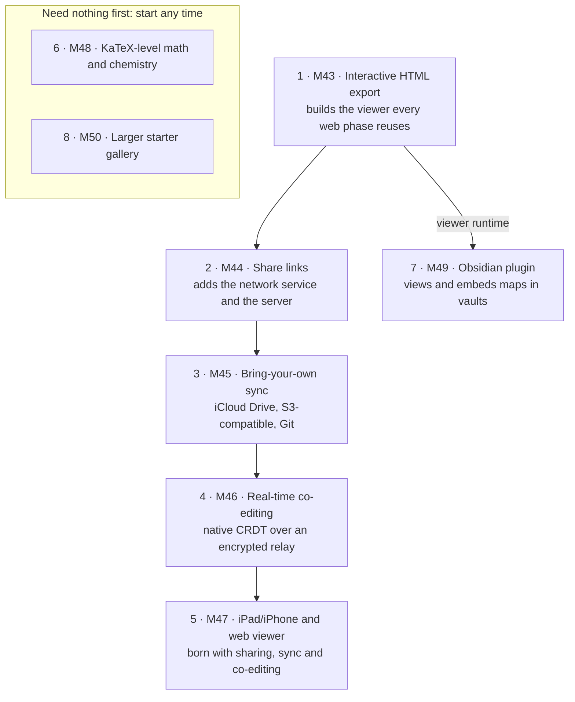
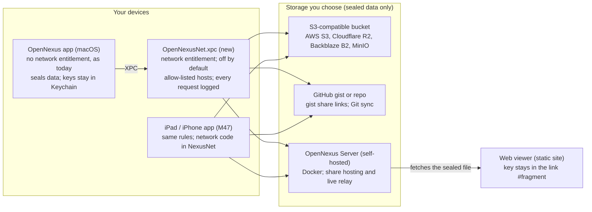

# OpenNexus Plan: Collaboration, Reach and Smaller Gaps (M43–M50)

Oct 28, 2026 · Jerry Voelker · written against the code at `66ed075` (0.3, after M42) · **Status: in progress.** Decisions #1–#3 were confirmed on Oct 28, 2026 and #4–#9 on Oct 29; the other rows in "Decisions for Jerry" stay pending until Jerry confirms them. Corrections from checking the plan against the code were folded in the same day.

This plan closes the eight gaps chosen from the [feature review](https://claude.ai/artifact/P9XpE1ituB1UgL9WXsZGjT) in eight milestones, M43–M50. Each phase is one milestone that Claude Code can plan, build, test and accept on its own, in the repo's existing style.

The order follows dependencies, not the review's list. A share link needs a page that shows a map in a browser, so Phase 1 builds that page as the Interactive HTML export, and share links come second. Collaboration (Phases 2–4) comes before reach (Phase 5), so the iPad/iPhone app is born with sharing, sync and co-editing. Math and the starter gallery don't depend on anything and can run at any time; the Obsidian plugin needs only Phase 1.

Every phase keeps the promises in `Handoff/AGENT_PROMPT.md`. Nothing leaves the Mac unless the user turns a network feature on. The app process itself still has no network entitlement. Shared and synced content is end-to-end encrypted, so no server ever sees a map. AI stays on device.

| Phase | Milestone | Delivers | Needs | Relative size |
| --- | --- | --- | --- | --- |
| 1 | M43 | Interactive HTML export, the shared viewer runtime, and a viewer copy inside saved files | — | M |
| 2 | M44 | Share links (end-to-end encrypted), the opt-in network service, and the OpenNexus Server (share hosting) | 1 | L |
| 3 | M45 | Bring-your-own sync: iCloud Drive and synced folders, S3-compatible buckets, Git | 2 | L |
| 4 | M46 | Real-time co-editing with presence, on a native CRDT and an encrypted relay | 2, 3 | XL |
| 5 | M47 | iPad and iPhone app; hosted web viewer | 1–4 | XL |
| 6 | M48 | KaTeX-level math and mhchem chemistry | — | M |
| 7 | M49 | Obsidian plugin | 1 | M |
| 8 | M50 | Starter gallery from 25 to about 100, plus save and install your own | — | M |

Sizes are relative to M0–M42, not estimates of time. Decisions that need your call before work starts are collected near the end.

## Phase order



Phases 2–5 run in sequence on the Phase 1 viewer and the network service that Phase 2 adds. The Obsidian plugin needs only Phase 1; math and the starter gallery need nothing, so they can run in parallel with anything.

## How Claude Code should run this plan

This plan lives at `docs/plans/collaboration-and-reach.md`. Every milestone follows the loop below, the same one M0–M42 used.

```markdown
You are continuing OpenNexus after M42. Read docs/plans/collaboration-and-reach.md end to end,
then README.md, Handoff/AGENT_PROMPT.md, docs/DECISIONS.md (skim), and the plan and results of
M38 (updates), M39-M41 (starters, guides) and M5/M42 (Present) for the patterns they set.

Work phase by phase in the plan's order (M43 first). For each milestone:
- Write docs/plans/M4x.md first: a short plan (modules, files, types, tests) ending in an
  "Accept when" list copied from this plan's acceptance table, tightened where the code demands.
- Build it. Record every choice the plan leaves open in docs/DECISIONS.md under
  "## M4x · <name>", numbering on from the last decision.
- Write the tests the phase lists and make them pass, with every existing test still green.
- Record results in docs/plans/M4x.md (acceptance table, built, changed from the plan,
  defects found, known gaps), then commit. Never start the next milestone with failing tests.

Stop and ask Jerry only when a choice is irreversible, costs money, or contradicts this plan or
the brief. Before a milestone starts, every row of the plan's "Decisions for Jerry" table whose
"Needed by" is that milestone (or earlier) must say Confirmed; if one is Pending, ask Jerry,
then write his answer into the table and into docs/DECISIONS.md.
```

### Conventions every phase follows

- **Amend the brief once.** M43's first decision records that this plan moves collaboration, sharing, sync and iPad/iPhone out of `Handoff/README.md` §15 ("Out of scope for v1"). It also replaces "no network calls" with the opt-in network rule in the next section.
- **Swift checks:** `swift test`, `scripts/lint.sh` and the `xcodebuild` app build pass. Existing goldens stay byte-identical unless the milestone says why they change.
- **File format:** schema additions only, in both schema copies; old files open unchanged; unknown keys still round-trip; the loader fuzzer covers every new field.
- **Keyboard and menus:** every new action is a registered command with a key, a menu item or a palette row; `KeyboardReachabilityTests` and the conflict check pass in all four key profiles.
- **Strings and accessibility:** new chrome text goes through `Loc`, the String Catalog is regenerated, and `axaudit` reports 0 issues on every new surface. Reduce Motion and Reduce Transparency are honoured.
- **Performance:** key-to-caret stays under 16 ms and 1,000-node reflow under 50 ms with any new feature switched on.
- **Privacy:** `NetworkPrivacyTests` is extended, never loosened silently (see the next section).
- **Web code** lives in a new `web/` npm workspace: TypeScript with no UI framework (Vue 3 if one is ever needed; no React). Its checks are typecheck, ESLint, Vitest and Playwright. Built bundles that the Swift package embeds are committed, and `scripts/lint.sh` fails when they are stale, as it already does for the document icon.
- **Server code** lives in a new `server/` Swift package, so the repo keeps one main language.

## Cross-phase architecture

Eight pieces are shared across phases. Each is built once, in the first phase that needs it, and that phase owns its tests.



The app keeps its sandbox without network access. Only the new service connects, only to hosts you configured, and everything it carries is sealed. The web viewer fetches the same sealed files, from a bucket, a gist or the server, and opens them with the key in the link.

### The network rule (replaces "no network calls")

1. **Off by default.** Settings › Privacy & Data gains one master switch, "Use the network for sharing, sync and collaboration", plus a switch per feature. With everything off, OpenNexus behaves exactly as 0.3 does and the Privacy card still reads "0 requests".
2. **Out of process.** A new XPC service, `OpenNexusNet.xpc` (in `Contents/XPCServices`, the pattern Sparkle's Downloader already uses), is the only macOS process with `com.apple.security.network.client`. The app and its five extensions keep no network entitlement. A new module, `NexusNet` (HTTP, AWS SigV4 signing, WebSocket), is linked only into that service on macOS and into the iOS app on iOS.
3. **Allow-listed.** The service talks only to hosts the user configured (a bucket endpoint, a server URL, `api.github.com`) and refuses everything else.
4. **Logged.** Every request is appended to an app-group log (time, host, method, purpose, bytes up and down), shown on the Privacy card with Export Log….
5. **Sealed.** Everything that leaves a device is sealed with AES-256-GCM (CryptoKit) under keys no server sees. Keys live in the Keychain (an access group shared with the service) or in a link's `#fragment`. The one opt-out is Git sync, where readable diffs are the point.
6. **Tested.** `NetworkPrivacyTests` changes from "no networking API anywhere" to "networking APIs only in `Sources/NexusNet`, `server/` and `web/viewer-app`" (the viewer site fetches sealed objects from M44). `web/viewer-core`, the viewer bundle the app embeds, and the Obsidian plugin stay free of them; M43 extends the test to cover the built viewer and `web/viewer-core`, which it didn't scan before. It also checks that `OpenNexusNet.xpc` is the only target with a network entitlement, that every network setting defaults off, and that the service refuses a host that isn't on the list.

### Shared pieces

| Piece | What it is | Built in | Used by |
| --- | --- | --- | --- |
| Viewer runtime (`web/viewer-core`) and `schema/viewer.schema.json` | A TypeScript viewer that draws an exported map bundle with pan, zoom, search, outline and topic details | M43 | Phases 1, 2, 5, 7 |
| Viewer copy in documents (`render/`) | The viewer bundle saved inside `.nexus` packages (and `.nexusjson` files behind their own switch), so a browser or Obsidian can show a map without the app | M43 | Phases 5, 7 |
| `NexusNet` and `OpenNexusNet.xpc` | Out-of-process HTTP and WebSocket, SigV4, allow-list, request log | M44 | Phases 2, 3, 4, 5, 8 |
| `Sealed` format (in `NexusFormat`) | Versioned AES-256-GCM envelope, PBKDF2 for passwords, key wrapping, readable from WebCrypto | M44 | Phases 2, 3, 4 |
| OpenNexus Server (`server/`) | Self-hostable Swift (Hummingbird) server in Docker: sealed share hosting (M44), live relay rooms (M46) | M44, M46 | Phases 2, 4, 5 |
| `NexusReplica` | The co-editing CRDT layer over `Patch` | M46 | Phases 4, 5 |
| `NexusScene` | The platform-neutral scene, measuring and exporters, split out of `NexusCanvas` | M47 | Phase 5 (and a later web renderer) |
| Hosted viewer site (`web/viewer-app`) | Static site on GitHub Pages that opens share links and local files | M44 (minimal), M47 (full) | Phases 2, 5 |

### Why no OpenNexus-run cloud

OpenNexus has no accounts and no company to run servers. Every network feature therefore works with storage the user already has (iCloud Drive, a bucket, GitHub) or with a server they run themselves (a Docker container on a home box or a VPS). Running a public default instance later is a decision for you, not a requirement of any phase.

## Phase 1 · M43 · Interactive HTML export and the viewer runtime

**Goal:** one self-contained `.html` file that opens offline in any modern browser and makes zero network requests. In it, the reader can pan, zoom, search, browse the outline and open notes, comments, links and attachments. The same viewer later powers share links (M44), the hosted web viewer (M47) and the Obsidian plugin (M49).

### What the reader gets

- Canvas tabs; pan by drag, trackpad or keys; zoom by wheel, pinch, + / − / 0; Fit.
- Two layouts per canvas: **As saved** (fold state as the author left it) and **Everything** (every branch open). Clicking a "+N" badge switches to Everything and flies to the branch.
- An outline panel: the canvas as a collapsible tree, floating topics included; clicking a row flies to the topic.
- A topic details panel: note, comments (author and date), hyperlinks (web links open in a new tab; topic links fly), attachments (when embedded), task line, labels, markers.
- Search as you type with case and whole-word toggles, highlighted matches, a result list, and ↩ / ⇧↩ to step through them.
- Keyboard: arrows move between topics spatially, ↩ opens details, `/` searches, Esc closes.
- The legend; for threat-model canvases, the threat table as an HTML table.
- Print: the current canvas fitted to the page.
- No watermark and no branding.

### How it works

- **Bundle format.** `ViewerBundle` JSON, published as `schema/viewer.schema.json` (version 1). Per canvas it holds: title, type and theme colours; two layouts (`saved`, `expanded`), each an SVG plus an index (topic id → frame, parent, depth, folded, hidden count; zone and relationship ids); the outline tree; per-topic details; the legend. Images and attachments are base64 assets keyed by content hash.
- **Drawing.** Each layout's SVG comes from the existing `SVGExporter` with `metadata` and `outlineText` on, so topics carry `data-nexus-id` and look identical without Apple's fonts. An invisible text layer, placed from the index, keeps text selectable and searchable. The viewer never lays a map out itself (decision below).
- **SVG parity (found when checking the plan against `66ed075`).** Today's `SVGExporter` draws shapes, lines, relationships, zones, boundaries, summaries, markers, labels and text, but not structure decor (braces, matrix and tree-table cells, swimlane bands, sequence lifelines and activation bars), callouts, topic images, stickers, pinned fields, technical decor (icons, kickers, captions, badges, accents, tints) or the +N fold badge. M43 brings it level with the canvas layers so A2 can hold for technical canvases. Outlined text is also made fast and compact: a number writer without `String(format:)` and regexes, and each glyph outline written once per SVG as a `<symbol>`, then placed with `<use>`. This changes the bytes of outlined SVG exports (no golden pins them).
- **Swift side.** `ViewerBundleBuilder` and `HTMLExporter` in `NexusCanvas` (they move to `NexusScene` in M47). The HTML is one file: inline CSS, inline viewer script, and the bundle in a `<script type="application/json">` block with `</` escaped. A `Content-Security-Policy` meta tag allows only that script (by its SHA-256 hash), inline styles and `data:` images, so the page cannot fetch anything.
- **Web side.** `web/viewer-core` (TypeScript, no framework) builds to one `opennexus-viewer.js` and one CSS file. The built copy is committed under `Sources/NexusCanvas/Resources/viewer/`, and `scripts/lint.sh` fails when it is stale.
- **Where you export.** In the export sheet's Document group, **Interactive HTML (.html)** has these options: Scope (document, canvas, branch, zone), Include notes / comments / attachments (with the size shown), Layouts (both, or as saved only), plus the existing Masking, Strip AI provenance and Theme override. It is also available as `nexus export --to html` (with `--branch` / `--zone`) and through the MCP `export` tool.
- **Viewer copy in documents.** On save, `render/viewer.json` is written inside `.nexus` packages, controlled by Settings › Files & Backup › "Save a viewer copy for browsers and Obsidian" (on). A `render` key inside `.nexusjson` files has its own switch, "Also in single-file documents" (off), because a single file can't git-ignore it and the copy would multiply its size and churn its diffs (decision #3). The exporters are `@MainActor` and build an offscreen canvas until M47 splits out `NexusScene`, so the copy is built on the main thread, coalesced and cached per document revision, within a measured budget; `preview.png` is built the same way today. `NexusPackage` knows only fixed paths, so the copy is added at both save sites (`NexusDocument`, `MapFiles.write`) as `preview.png` is. Like `preview.png`, it is never written for encrypted documents and is listed in the generated `.gitignore`. `nexus validate` checks it against the schema.

**Untrusted content.** A bundle can come from anyone once share links and Obsidian exist, so the viewer sanitises every SVG and text field with an allow-list before inserting it. That means no `script`, no event attributes, no `foreignObject`, no external references, and links only to `http(s)`, `mailto`, `obsidian` and `opennexus`. A crafted malicious bundle is part of the Playwright suite.

### Steps

1. SVG parity and speed: the missing drawing listed above, the fast number writer and the glyph cache.
2. Schema, `ViewerBundle` model and builder, with golden bundles for LaunchPlan, TaskPlan, Review, a flowchart and the threat model.
3. The `web/` npm workspace: strict TypeScript, ESLint, Vitest, Playwright (Chromium, WebKit, Firefox).
4. Viewer features, in the order listed above.
5. `HTMLExporter`, the CSP hash, the export sheet section, the CLI and MCP formats.
6. The viewer copy on save, its settings, schema keys and `.gitignore` line.
7. `NetworkPrivacyTests` covers the built viewer and `web/viewer-core`.

Not planned: an interactive Quick Look preview. Quick Look's HTML previews don't run JavaScript, so the extension keeps its static `preview.png` page.

### Accept when

| # | Criterion |
| --- | --- |
| A1 | An export of LaunchPlan opens from disk in Chromium, WebKit and Firefox (Playwright) with an empty request log and no console errors. |
| A2 | Each canvas's As saved layout, rasterised in the browser, matches the app's PNG export within the golden tolerance (mean delta < 2%). Needs the SVG parity step; checked for the five golden documents, technical canvases included. |
| A3 | Playwright covers tabs, pan, zoom, Fit, both layouts, outline fly-to, details content, keyboard navigation, and search, whose match count equals the app's Find for the same query. |
| A4 | Branch and zone scopes export only their topics; masked strings and excluded comments are absent from the file's bytes; attachments are embedded only when chosen. |
| A5 | A 1,000-topic map exports in under 1 s (debug build) and is interactive in under 1.5 s in Chromium; the viewer script and CSS together are at most 150 KB gzipped. The export time depends on the SVG writer's speedups (fast numbers, glyph cache). |
| A6 | axe-core reports no serious or critical issues; the outline is an ARIA tree; every topic is focusable with the app's spoken description as its label. |
| A7 | Saved packages carry a valid `render/viewer.json`; encrypted documents never do; with the setting off there is none; a `.nexusjson` carries a `render` key only when its own switch is on; everything else in the file round-trips byte for byte. |
| A8 | `nexus export --to html` produces the same bytes as the export sheet for the same options. |
| A9 | The quality bars in "How Claude Code should run this plan". |

### Decisions to record

- Text is drawn as outlines with an invisible text layer, because Apple's system fonts can't be embedded or redistributed and other platforms lack them.
- No layout engine in the browser for now: two precomputed layouts per canvas plus the outline. Running the Swift layout engine as WebAssembly is evaluated in M47.
- The viewer copy in documents is on for packages and off for single-file documents (decision #3, confirmed).

**Out of scope:** editing in the browser, presenting in the browser (M47), live updates (M46/M47).

## Phase 2 · M44 · Share links

**Goal:** File › Share Link… turns a document, canvas, branch or zone into a link anyone can open in a browser. The map is sealed before it leaves the Mac, and the key travels only in the link's `#fragment`, which browsers never send to a server. The storage holds ciphertext, and the viewer site never sees the key.

### User flow

1. Share Link… (File menu, the toolbar's share button, ⌘K; a free chord picked with the conflict checker) opens a sheet with: Scope; Include notes, comments and attachments; Masking (the existing ask / always / never); Password (optional); Expires (never, 1 day, 7 days, 30 days, a date); Destination.
2. Create Link seals, uploads with progress, copies the link and shows it with a QR code, Copy, Open in Browser and the system share menu.
3. File › Manage Share Links… and a new Settings › Sharing pane list every link: document, scope, created, expires, destination, password yes/no. Each has Copy, Update (re-publish to the same address, so the link doesn't change), Revoke (delete the object) and an optional "Update when I save".
4. With the network switched off, the command explains why and offers Settings.

### Destinations

Each is a `ShareTarget` (put, update, delete, public URL). The user can configure several and pick one per link.

| Destination | Setup | Notes |
| --- | --- | --- |
| S3-compatible bucket (AWS S3, Cloudflare R2, Backblaze B2, Wasabi, MinIO) | Endpoint, region, bucket, prefix, access key and secret (Keychain), public base URL | A Set Up CORS button applies the bucket's CORS rule for the viewer's origin; Test round-trips an object. Optional lifecycle rule for expiry. |
| GitHub Gist | Personal access token with `gist` scope | Secret gist holding the sealed file as base64. The viewer reads it through the GitHub API, which allows browser requests; the 1 MB truncation and raw-URL fallback are handled. |
| OpenNexus Server (self-hosted) | Server URL and an upload token from its config | Expiry and size limits enforced by the server; revoke is immediate. |
| No server | — | The existing Interactive HTML export, for email or AirDrop. |

### The sealed envelope (shared with M45 and M46)

- `Sealed` in `NexusFormat`: magic `ONX1`, a small JSON header (algorithm, content type, bundle version, created, and KDF parameters when a password is used), a 12-byte nonce, then the ciphertext and tag. The header is the associated data, so it can't be altered.
- The content is the M43 `ViewerBundle`, deflated, then sealed with AES-256-GCM. Browsers open it with WebCrypto and `DecompressionStream`.
- Random 32-byte key in the fragment; with a password, PBKDF2-SHA256 instead and no key in the link. Record the iteration count as a decision.
- Link shape: `https://<viewer>/s/#1.<destination>.<locator>.<key>`. The viewer address is a setting, so anyone can host the static viewer themselves.

### The viewer site, minimal

`web/viewer-app` gets one route in M44, opening share links. It parses the fragment, fetches the sealed object without credentials, decrypts, validates against the schema and draws with `viewer-core`. It has clear pages for: link turned off or expired (404), wrong password, damaged or tampered (tag check fails), and made by a newer OpenNexus. It deploys as a static site to GitHub Pages (decision on the address).

### OpenNexus Server, part 1

It is a new `server/` Swift package (Hummingbird 2) with a Dockerfile and a Compose example that includes Caddy for TLS. In M44 it serves only sealed shares:

- `POST /v1/shares` with the upload token returns an id and a per-share write secret.
- `GET` allows any origin; `PUT` and `DELETE` require the write secret.
- It enforces expiry, size limits and a rate limit, and stores to disk or to an S3-compatible bucket.

It never needs or sees keys. It is documented for a home server (Docker on ZimaOS needs sudo), a VPS or Fly.io.

### Steps

1. `NexusNet`, `OpenNexusNet.xpc`, the allow-list, the request log, the Privacy card changes and the new `NetworkPrivacyTests`.
2. `Sealed`, with cross-checks against WebCrypto in Playwright (Swift seals, the browser opens, and the reverse).
3. The three destinations: S3 (SigV4 written in Swift, tested against MinIO in Docker), GitHub Gist (against recorded API fixtures), the server.
4. `server/`, its tests and its image.
5. The share sheet, the link store (records in the app container, keys in the Keychain, nothing written into the document), Manage Share Links, Settings › Sharing.
6. The viewer app's share route and its Pages deployment.

### Accept when

| # | Criterion |
| --- | --- |
| A1 | Every network setting is off on a fresh install; the app and extensions still have no network entitlement; `OpenNexusNet.xpc` refuses a host that isn't configured; every request appears in the log with its byte counts. |
| A2 | For each destination (MinIO, the server in Docker, the Gist fixtures), Create Link then opening the link in Chromium, WebKit and Firefox shows a bundle equal to the HTML export of the same scope. |
| A3 | The stored object contains none of the map's topic, note or comment strings; a wrong key or a flipped byte fails with the damaged-link page. |
| A4 | A password link carries no key; a wrong password fails cleanly; the right one opens. |
| A5 | Update keeps the same link and shows the new content; Revoke makes the link show "turned off"; an expired link does the same. |
| A6 | Masking and Strip AI provenance behave exactly as in Export. |
| A7 | The server's tests cover auth, write secrets, expiry, size and rate limits and CORS headers; `docker build` succeeds and the Compose example starts. |
| A8 | Quality bars; Settings › Sharing is searchable; every new command is reachable from the keyboard. |

**Out of scope:** comments from people viewing a link, view counts (never: no analytics), an OpenNexus-run default host.

## Phase 3 · M45 · Bring-your-own sync

**Goal:** maps follow the user across Macs, and later iPads and iPhones, through storage they already own. Sync never silently loses an edit. It reuses the three-way `DocumentMerge` from M9, extended to report clashes and let the user choose.

### Three ways to sync

| Way | Who moves the bytes | What OpenNexus adds |
| --- | --- | --- |
| iCloud Drive, Dropbox, Google Drive, Syncthing, a NAS share | The system or the sync app (no network use by OpenNexus) | Correct file coordination for packages; merging iCloud's conflict versions and other apps' "conflicted copy" files instead of picking one; downloading iCloud placeholders on open with progress |
| S3-compatible bucket, as in Mind Elixir | `OpenNexusNet.xpc` | A library mirrored to the bucket: content-addressed files, compare-and-swap heads, three-way merges, deletion sync, optional end-to-end encryption, history |
| Git | The user's own `git` (tier 1), or OpenNexus itself (tier 2, a decision for you) | A semantic merge driver and readable diffs, so two people editing different topics never conflict |

### Synced library

- A library is a folder the user picks (security-scoped bookmark) and connects to a bucket. Home lists it as a location with a status per document: synced, syncing, offline, conflict.
- Every document gets a stable id in `manifest.json` if it lacks one (an addition to the schema).
- `NexusSync` (platform-neutral, in the Swift package) keeps per document a base copy (the last synced version, in the app container), the remote head it came from, and a dirty flag. It talks to the network through a `Transport` protocol, which the XPC client implements on macOS.

### S3 sync in detail

- **Layout:** `<prefix>/library.json` (documents, titles, heads, tombstones); `docs/<id>/head.json` (revision id, parent, device, time, and a map from each package path to its blob name); `docs/<id>/blobs/<name>` holding every file once, so unchanged canvases and images are never uploaded again; `docs/<id>/heads/<rev>.json` for history.
- **Encrypted by default:** each blob is sealed with a random library key; blob names are an HMAC of the content under that key, so equal files dedupe without revealing anything. The key lives in the Keychain (optionally iCloud Keychain) and can be exported as a recovery phrase and QR code for another device. Unencrypted mode is available for people who want a readable bucket, as Mind Elixir has.
- **Push:** upload missing blobs, then replace `head.json` only if its ETag is unchanged (conditional write). If the head moved, pull, merge base · local · remote, save, push again. The Test button checks that the provider honours conditional writes; if it doesn't, write and then re-read to verify, and record which providers needed that.
- **Pull:** if the remote moved and nothing changed locally, fast-forward. An open document takes remote changes as one undo step ("Updated from sync · ⌘Z undoes"), as M9 does for external edits.
- **When:** after a save (debounced), when the window gains focus, on an interval (setting), at launch, and with Sync Now.
- **Deletes:** tombstones in `library.json`. A remote copy is moved to `trash/` for 30 days (setting), and other devices move their local copy to the macOS Trash.
- **History:** Sync History… restores an earlier head as one undo step, next to the existing recovery snapshots.
- **Settings › Sync** (new pane): providers, libraries, interval, encryption key (show recovery phrase, import), Sync Now, Reset Sync State, and the sync log.

### Conflicts

Extend `DocumentMerge` to return each clash as data (where, base, mine, theirs) instead of a string. Silent "app wins" stays the behaviour for agents and the CLI. Sync opens a Resolve Conflicts sheet instead: per clash it offers Mine or Theirs, or keeps both as a conflict-copy canvas. The whole resolution is one undo step.

### Git

- **Tier 1 (this phase):** `nexus merge-driver %O %A %B %P` merges canvas JSON files, `manifest.json`, `theme.json` and `.nexusjson` files topic by topic with `DocumentMerge`, writes canonical JSON, and exits non-zero only on a true clash, listing it. `nexus git setup` writes the `.gitattributes` lines and the `git config` entries and is safe to run twice. `nexus git textconv` gives readable outline diffs ("+ Pricing under Launch").
- **Tier 2 (decision for you):** an in-app Git library using libgit2 inside the network service (HTTPS with a token; commit on save, pull and merge, push). The recommendation is to defer it until after M47.

### Accept when

| # | Criterion |
| --- | --- |
| A1 | A property test with 2–3 replicas, random edits and random sync order against MinIO in Docker converges to byte-identical documents over 50 seeds, losing nothing except clashes it reported. |
| A2 | Two devices changing the same topic produce one clash; each choice keeps exactly that side; resolution is one undo step. |
| A3 | With encryption on, no bucket object or name contains a topic string; a second device with the recovery phrase syncs; without it, it can't. |
| A4 | Editing one canvas of a three-canvas document with images uploads only that canvas's blob and the head (counted in the request log). A 1,000-topic document pushes in under 2 s to MinIO on the local network. |
| A5 | Killing the process between blob uploads and the head write loses nothing, and the next sync completes. |
| A6 | Deletes reach other devices; Restore brings a document back from the remote trash. |
| A7 | iCloud conflict versions and Dropbox/Syncthing conflicted copies are offered for merging (controller tests with synthetic versions and files). |
| A8 | In a temp Git repo, two branches editing different topics of one canvas merge cleanly with the driver (plain Git conflicts); the same topic exits non-zero with the clash listed; `nexus git setup` is idempotent. |
| A9 | Typing latency is unchanged while a sync runs; quality bars. |

**Out of scope:** real-time merging (M46), Git tier 2 unless you choose it, syncing settings or themes between devices.

## Phase 4 · M46 · Real-time co-editing

**Goal:** several people edit one document at the same time from their own Macs (iPads and iPhones join in M47). They see each other's selections and edits as they happen, every copy ends up identical, ⌘Z undoes only your own changes, and the relay sees only sealed bytes.

### User flow

1. File › Collaborate… (also in the share menu): pick a configured OpenNexus Server and whether invitees can edit or only view, then Start. The sheet shows an invite link (QR, Copy, share menu).
2. Opening the link on a Mac with OpenNexus joins the session. The joiner chooses where to save their copy; until then it lives in the app container. Without the app, the link's page offers the download and the last shared snapshot (live viewing in a browser is out of scope).
3. During a session:
   - The toolbar shows an avatar row (the name from Settings › Editing › Comment author, a colour from the palette) and a status pill ("Live · 3 people", "Reconnecting…").
   - Each person's selection ring and name tag show in their colour, with an "editing" mark on topics being typed in.
   - Clicking an avatar follows that person's view.
4. Leave Session keeps your copy. The host's End Session closes the room and deletes its data from the server. Removing one person means ending and starting a new session, because the room key can't be taken back.

### Replication: `NexusReplica`

A new module on top of `NexusCore`. The `.nexus` file stays canonical JSON. The CRDT is metadata kept beside it while a session lasts.

- **Clock:** a replica id per join and hybrid logical clock timestamps.
- **Ops from patches:** every committed `Patch` is diffed into field-level ops: create topic, set field, move, delete; the same for each element kind, canvas settings (by key path), canvases and tab order, custom themes, and comments. Remote ops are turned back into a `Patch`, so drawing, VoiceOver, autosave and the outline need no new paths.
- **Fields:** last-writer-wins per field (text, note, style, markers, labels, task fields, links, image…).
- **Tree:** Kleppmann's move operation (undo, apply, redo in timestamp order), so concurrent moves can never form a cycle. Sibling order uses fractional index keys with the replica id as tie-break. Delete is a move under a trash root, so undoing a delete is a move back.
- **Ids:** topic ids are sequential per canvas today (D5) and would collide. During a session new ids carry a replica suffix. The schema's id pattern (`^[A-Za-z0-9_-]+$`) already admits a suffix such as `n12-r3`; check that every reader of ids does too.
- **Topic text:** last writer wins, plus a soft lock. While someone types, others see "Ana is editing" and get a gentle hint if they start typing there too. A character-level text CRDT for notes is a follow-up, not this phase.
- **Undo:** remote patches never enter your undo stack. Undo becomes selective: it emits inverse ops only for fields that still hold the value you set, so it never reverts someone else's later change.
- **Everything else rides along:** accepted AI ghosts (with ✦), MCP agent edits (through the M9 external-change path), comments, tasks and Gantt edits, Present settings.
- **Persistence:** replica metadata and unsent ops are kept in the app container by document and session, so a crash or an offline stretch resumes and converges.

### Relay: OpenNexus Server, part 2

- WebSocket `/v1/rooms/:id`. A room is created with hashes of two capabilities, read and write, both carried in the invite link's fragment. The relay rejects op messages without write capability.
- Message types: hello, sealed op batch, sealed presence, snapshot request, sealed snapshot. The relay numbers messages per room, fans them out, and keeps the sealed op tail plus the latest sealed snapshot (uploaded by an editor every N ops) for people who join late.
- Room data is deleted on End Session or after an idle period (server config).
- Presence (viewport, selection, editing, pointer) is throttled to 10 updates a second and never stored.

### Alternatives considered

| Option | Why not first choice |
| --- | --- |
| Loro (Rust CRDT with a movable tree) | Its Swift bindings describe themselves as experimental, and it adds a Rust binary to a package that has no dependencies (D2). Keep it as the fallback if the native tree move proves too costly. |
| Automerge | No move operation for trees; moving branches is OpenNexus's core gesture. |
| CloudKit sharing | No server to run, but updates arrive in seconds, not real time, and it is Apple-only. Better suited to async sharing later. |

### Accept when

| # | Criterion |
| --- | --- |
| A1 | A property test with 3–5 in-process replicas, every op kind, and random, duplicated and out-of-order delivery ends with byte-identical canonical JSON and a valid tree on every replica, over 200 seeds. |
| A2 | Concurrent "A under B" and "B under A" end in the same acyclic tree everywhere. |
| A3 | Undo on one replica never reverts another replica's later change to the same field; undo and redo of your own changes pass the existing undo property test inside a session. |
| A4 | Two Macs through a relay on the local network: a remote edit shows in under 150 ms (median); key-to-caret stays under 16 ms with three people typing. |
| A5 | Relay traffic and storage contain no plaintext; a view-only participant's ops are rejected; End Session deletes the room's data. |
| A6 | A late joiner's document (snapshot plus op tail) equals the live one byte for byte. |
| A7 | Selections, name tags and editing marks show for every participant; VoiceOver announces joins, leaves and who is editing the focused topic. |
| A8 | Offline edits converge after reconnecting; killing the app mid-session and reopening resumes. |
| A9 | Server tests cover room auth, capabilities, fan-out, retention and limits, plus a load run of 10 editors at 10 ops a second each. |
| A10 | Quality bars. |

**Out of scope:** live editing or watching in the browser, voice or chat, removing one person without ending the session, character-level merging of topic text.

## Phase 5 · M47 · iPad/iPhone app and web viewer

**Goal:** OpenNexus on iPad and iPhone with the same maps, keyboard flow, on-device AI, sharing, sync and co-editing; and a hosted web viewer that opens share links and local files in any browser. This is the largest phase, so it runs as four sub-milestones, each with its own plan file and results: M47a → M47b → M47c, with M47d in parallel.

### M47a · Platform split

`NexusCore`, `NexusLayout`, `NexusFormat`, `NexusTheme` and `NexusKeys` already import only Foundation and CoreGraphics. `NexusCanvas` imports AppKit in 67 of its 83 files (at `66ed075`), including the scene, the measurer and the exporters. So:

- **`NexusScene`** (new, no AppKit or UIKit): `Scene`, `SceneTechnical`, `NodeMeasurer`, `RichFormats` (math and code), `SVGExporter`, `ImageExporter`, `SlideExporter`, print layout, Gantt layout and renderer, legend and decor drawing, `ViewerBundleBuilder`, `HTMLExporter`. Swap NSColor for CGColor, NSFont for CTFont, NSBezierPath for CGPath, NSImage for CGImage, and AppKit attribute keys for CoreText's. Layers that use only QuartzCore (topic, element and legend layers) move here too.
- **Editing logic:** split `CanvasController` behind a small `CanvasHost` protocol for what is platform UI (menus, popovers, panels, first responder), so commands, selection, Connect, Present and AI flows are shared.
- **`NexusAI`:** replace its AppKit uses with CGImage; Foundation Models, Vision, Translation, Speech and Image Playground exist on iOS.
- **`NexusKeys`:** add `KeyChord+UIKey` beside `KeyChord+NSEvent`.
- **WebAssembly spike (time-boxed):** build `NexusCore`, `NexusLayout`, `NexusTheme` and `NexusScene`, with a pluggable text measurer, for WebAssembly with the Swift SDK. Measure size, 1,000-topic layout time and text-metric drift, and record a decision on whether the browser should lay maps out itself. That would unlock folding with reflow and viewing files without a viewer copy.

### M47b · iPad

- **Target:** `OpenNexus iOS` (iPadOS and iOS 27, matching the macOS 27 floor). SwiftUI app shell; a UIKit canvas, `NexusTouch`, hosting the same layers.
- **Documents:** `.nexus` packages and `.nexusjson` through the document browser, Files, iCloud Drive and other providers; starter picker; recents.
- **Touch:**
  - Tap selects, double-tap edits, drag moves or reparents with the existing drop hints, long-press opens the same context menus (built from the registry).
  - Pinch zooms, two fingers pan, drag on empty canvas selects with a band.
  - Apple Pencil: Scribble writes topic text; hover shows fold controls.
- **Hardware keyboard:** every registered command becomes a `UIKeyCommand` (hold ⌘ for the list), so the full Xmind-style keyboard flow, ⌘K, ⌘J and Connect mode work with a Magic Keyboard.
- **Panels and modes:** Format panel as an inspector, Outline and Split, Focus, ZEN, filter, find, navigation panel, AI panel and ghosts, image to map (plus the VisionKit document camera), Gantt, and Present on an external display or AirPlay with the presenter view on the iPad.
- **Network features:** share links, S3 sync and co-editing. On iOS `NexusNet` runs in-process with the same opt-in switches and request log.
- **Extensions:** Quick Look preview and thumbnail, Share extension (capture to Inbox), Inbox and Recent Maps widgets, App Intents, Core Spotlight indexing.
- **Not on iOS:** the `nexus` CLI, the MCP server, Services, the global Quick Capture hot key, code links, Sparkle (TestFlight and the App Store instead; decision).
- A privacy manifest declaring no tracking and no collected data.

### M47c · iPhone

The same app at compact width:

- Outline first, with a canvas toggle.
- A bottom toolbar on the canvas: add child, add sibling, style, more.
- Capture to the Inbox from widgets and the Share sheet.
- Reading and commenting.
- Presenting over AirPlay.

Technical diagrams are editable but tuned for viewing.

### M47d · Web viewer, full

`web/viewer-app` grows from M44's share route into a full viewer:

- Open a `.nexusjson`, a `.nexus` folder (directory drop or the File System Access API) or a zipped package, using its viewer copy. Files without one show the outline and say how to add one.
- Present in the browser: the deck in its saved order, flying between topic frames from the index.
- An installable PWA that works offline.
- An embed mode for iframes in wikis.
- An Open in OpenNexus button.

If the WebAssembly spike succeeds, a read-only live view of a co-editing session is added here; otherwise it stays out of scope.

### Accept when

| # | Criterion |
| --- | --- |
| A1 | After the split, the Mac app is unchanged: all existing tests pass and the style, theme and exporter goldens are byte-identical. A lint check fails if `NexusScene` or any module below it imports AppKit or UIKit. |
| A2 | On iPad, the F1 test (a 20-topic, 3-level map) passes with a hardware keyboard only, and again with touch only, in XCUITest. |
| A3 | Offscreen renders of the 36 style × theme goldens on iOS match the Mac's within the golden tolerance. |
| A4 | On an M-series iPad: key-to-caret under 16 ms, 1,000-node reflow under 50 ms, and smooth pan and zoom at 5,000 nodes on ProMotion. |
| A5 | A document edited on a Mac and an iPad through iCloud Drive and through an S3 library merges correctly. An iPad joins a Mac's co-editing session and converges. A share link made on iPad opens in a desktop browser. |
| A6 | VoiceOver reads and acts on the canvas on iOS (the M10 tree, ported); Dynamic Type and Scribble work; `performAccessibilityAudit` reports 0 issues. |
| A7 | iPhone: capture from the widget to the Inbox, edit in the outline, present over AirPlay. |
| A8 | The web viewer opens a `.nexusjson`, a `.nexus` folder and a zipped package in Chromium, WebKit and Firefox; falls back to the outline without a viewer copy; presents the deck; works offline as a PWA; embed mode hides the chrome. |
| A9 | On iOS every network setting defaults off and all network code is in `NexusNet`; the privacy manifest validates. |
| A10 | The WebAssembly spike's numbers and recommendation are recorded as a decision. |

**Out of scope:** editing in the browser, Apple Watch, visionOS, Android.

## Phase 6 · M48 · KaTeX-level math and chemistry

**Goal:** replace the `/math` LaTeX subset (`MathText` in `RichFormats.swift`, which builds attributed text) with full TeX math: matrices, aligned equations, cases, arrays, accents, braces, colours, boxes, cancel, calligraphic and fraktur letters, and mhchem chemistry (`\ce{}`, `\pu{}`). It must render as vector shapes everywhere: the canvas, PNG, SVG, PDF, print, Present, the HTML viewer and iOS. It also adds inline `$…$` and display `$$…$$` in topics and notes, as Mind Elixir has.

### Engine

- MathJax (Apache-2.0) with TeX input (all packages, including mhchem and cancel) and SVG output, running in JavaScriptCore with MathJax's lite DOM adaptor. No WebKit and no network are needed, and it works the same on macOS and iOS. [MathJaxSwift](https://github.com/colinc86/MathJaxSwift) (MIT) shows the approach works.
- Recommended: vendor MathJax's built component under `NexusScene/Resources/mathjax/` (or `NexusCanvas` if M47 hasn't run) with a small Swift bridge, keeping the package free of Swift dependencies. Using MathJaxSwift as a dependency is the alternative. Pin the MathJax version and record it.
- **Pipeline:** TeX → MathJax SVG → the existing SVG path parser (M2) → `MathGlyphs` (paths, width, height, depth) → measured by `NodeMeasurer` like any text run → drawn as filled paths in the topic's text colour → written as paths by every exporter. MathJax's fonts become paths, so there is no font licensing issue.
- **Speed:** the JavaScriptCore context starts lazily off the main thread. Results go in an LRU cache keyed by source, display mode and size; colour is applied at draw time. Until a formula is ready, its source shows, so typing is never blocked.

### Writing math

- `/math` blocks stay display math. `/chem` inserts `\ce{}`.
- `$…$` inline and `$$…$$` display in topic text and notes, with `\$` for a literal dollar sign. A setting, Settings › Editing › "Typeset math in text", defaults on.
- While you edit, the editor shows the source with a live preview beneath it. Errors show the source in the error colour with MathJax's message on hover, and never crash or block.
- **VoiceOver:** each formula's label is MathJax's speech text if its speech engine fits the size budget; otherwise it is the TeX source (decision).

### Interchange

- Markdown exports and imports `$…$` and `$$…$$`.
- Xmind equation topics round-trip as before.
- Word export embeds formulas as vector images (native Word equations are a later option).
- OPML and plain text keep the source.
- The HTML viewer needs nothing new, because formulas are already paths in its SVG.

### Accept when

| # | Criterion |
| --- | --- |
| A1 | A coverage corpus built from KaTeX's supported-functions list (one line per command or environment) renders every entry without error. 40 representative formulas match committed SVG goldens: fractions, matrices, aligned, cases, reactions with arrows, states and charges, and units. |
| A2 | Every `/math` input that worked in 0.3 still renders, and 0.3 documents round-trip byte for byte. |
| A3 | SVG and PDF exports contain formulas as paths with no raster images; the HTML viewer shows them identically. |
| A4 | Key-to-caret stays under 16 ms while editing a topic with math. A warm render takes under 5 ms (median). A map with 200 formulas opens less than 1 s slower than the same map without them. |
| A5 | Inline and display math work in topics and notes; `\$` escapes; with the setting off the text shows as typed. |
| A6 | 1,000 random malformed inputs never crash and always show an error state. |
| A7 | Formulas have VoiceOver labels; contrast checks include math colour. |
| A8 | Markdown and Xmind round trips keep formulas; Word export includes them. |
| A9 | The same corpus renders identically on iOS (once M47 has run). |
| A10 | Quality bars; MathJax's licence and notice appear in About › Acknowledgements. |

**Out of scope:** a visual equation editor, native Word (OMML) equations, AsciiMath input.

## Phase 7 · M49 · Obsidian plugin

**Goal:** OpenNexus maps live comfortably in Obsidian vaults. People can open and explore maps in Obsidian, embed them in notes, jump to OpenNexus to edit, and see any Markdown note as a map, which matches Mind Elixir's plugin. It is built on M43's viewer runtime and the viewer copy saved in documents.

### Features

1. **Map view.** `registerView` plus `registerExtensions(['nexusjson'])` opens `.nexusjson` files in a read-only view drawn by `viewer-core` from the file's viewer copy. Single-file documents carry one only when "Also in single-file documents" is on (decision #3); otherwise the view renders through the `nexus` tool on macOS or shows the outline, and says how to turn the copy on. It reloads when OpenNexus saves the file (vault `modify` events). Obsidian treats `.nexus` packages as folders, so the folder menu gains "Open as OpenNexus map" for folders ending in `.nexus`, which reads `render/viewer.json`.
2. **Embeds.** A ```` ```nexus ```` code block takes `file:`, plus optional `canvas:`, `topic:` (zoom to a branch), `layout:` and `height:`. It shows an interactive map in Reading view and Live Preview. Embeds start only when scrolled into view, so long notes stay smooth. Obsidian's internal embed registry isn't used, because it isn't public API.
3. **Links.** Wikilinks and `obsidian://` links in topic notes and hyperlinks open vault notes through the workspace API. "Copy link to topic" gives a link that reopens the map at that topic.
4. **Edit in OpenNexus.** A button and command open the file in the Mac app (desktop only), and the view refreshes when the app saves.
5. **Note as map.** "Show this note as a map" opens a side view of the active note's headings and bullets as a map, updated as you type (debounced).
   - On macOS it calls the `nexus` tool that ships inside the app (not sandboxed, so it can read the vault). A new subcommand renders Markdown from stdin to a viewer bundle on stdout, using the existing Markdown importer and a chosen structure.
   - Clicking a topic moves the editor's cursor to that line, so the importer keeps source line numbers in the index. The note stays the source of truth.
   - Without the app (other systems, mobile), it shows the outline, or a laid-out map if M47's WebAssembly spike succeeded.
6. **Conversions.** "Convert note to OpenNexus map" writes a `.nexusjson` beside the note (`nexus import`). "Insert map as outline" writes a map's Markdown export into the note.
7. **Settings tab:** path to `nexus` (found automatically), default layout, embed height, whether the viewer chrome follows Obsidian's theme.

### Packaging

- Source in `web/obsidian/` (TypeScript, esbuild, the official sample plugin's layout). It builds `main.js`, `manifest.json` and `styles.css`.
- `isDesktopOnly: false`; app-dependent features are hidden unless `Platform.isDesktopApp` and macOS.
- Obsidian's community directory expects a repo with `manifest.json` at its root and releases carrying those files. A release script therefore mirrors `web/obsidian/` into a separate public repo (decision: name), tags it and attaches the assets. Check the current submission rules at submission time.
- It makes no network requests, inserts no untrusted HTML, and cleans up everything on unload (`registerEvent`, `registerDomEvent`).

### Security note (applies back to M43)

A map can come from anyone: a share link, a vault from a friend. The viewer treats its SVG and text as untrusted. They are sanitised with an allow-list (no `script`, event attributes, `foreignObject` or external references; only `http(s)`, `mailto`, `obsidian` and `opennexus` links) before insertion. M43 builds this sanitiser; M49 re-tests it inside Obsidian.

### Accept when

| # | Criterion |
| --- | --- |
| A1 | With the `obsidian` module mocked (Vitest), the view, code-block processor, folder menu, commands and settings register and unregister cleanly. |
| A2 | Hand-checked on desktop and on Obsidian for iOS against a committed test vault (`web/obsidian/test-vault/`), with results recorded: view, embeds, links, live reload within 1 s of an OpenNexus save. |
| A3 | Note as map on macOS equals `nexus import` of the same Markdown; clicking a topic moves the cursor to its line; it updates within 1 s of a typing pause. |
| A4 | A crafted bundle with script tags, `on*` attributes and `javascript:` links renders inert in Obsidian, in the HTML export and on the viewer site. |
| A5 | `main.js` plus `styles.css` is at most 300 KB; the release script produces assets that install by hand into a fresh vault. |
| A6 | Typecheck, ESLint and Vitest pass; Swift quality bars pass for the new `nexus` subcommand. |

**Out of scope:** editing maps inside Obsidian (other than through the note-as-map source), Canvas (`.canvas`) conversion, Obsidian Sync specifics.

## Phase 8 · M50 · Larger starter gallery

**Goal:** grow the built-in gallery from 25 starters to about 100, so every one of the 16 diagram types has at least three. Let people save, share and install their own starters. Keep the M40 picker fast and keyboard-friendly at that size. Starters stay data, in JSON validated by `schema/starter.schema.json`, so this phase is mostly content plus a few features.

### New built-in starters (75)

| Shelf | New | Examples |
| --- | --- | --- |
| Business and strategy | 10 | Business model canvas, lean canvas, PESTLE, five forces, OKR tree, value proposition, competitor comparison, go-to-market plan, stakeholder map, decision matrix |
| Engineering and software | 10 | System design, API design, database schema, bug triage flow, Git branching flow, CI/CD pipeline, login sequence, postmortem, tech debt register, code review checklist |
| Product and design | 8 | User story map, customer journey, persona, PRD outline, RICE prioritisation, jobs to be done, release plan with dates, design critique |
| Process and operations | 8 | Employee onboarding swimlane, purchase approval swimlane, support escalation flow, SIPOC, value stream, 5 whys, Ishikawa 6M, change request flow |
| Planning and projects | 8 | Work breakdown structure, project charter, event plan, launch checklist with tasks, dated project for the Gantt view, sprint plan, quarterly roadmap (alternating timeline), RACI |
| Thinking and learning | 8 | Brainstorm whiteboard, Cornell notes, lecture notes, literature review, research plan, argument map, language learning, study schedule |
| Security and risk | 6 | Web app threat model, mobile app threat model, kill chain timeline, incident severity decision flow, risk register, zero-trust architecture |
| Architecture and cloud | 6 | Three-tier web app, Kubernetes deployment, event-driven system, data pipeline DFD, serverless app, network segmentation |
| Personal and life | 6 | Goal setting, weekly planner, habit tracker, moving checklist, budget plan, reading list |
| Meetings and teams | 5 | One-on-one agenda, team charter, start/stop/continue retro, workshop agenda, decision log |

The examples are a starting list; Claude Code may swap items as long as the counts per shelf and per type hold. New shelves are schema additions mapped to the existing six categories and to Home's role filter. Note: `schema/starter.schema.json` already has two fields, `shelf` (Home's five role shelves) and `category` (the picker's six), and these ten shelves are neither. M50 must decide whether they become a third field or new categories, and record it.

### Content rules (a lint script enforces what it can)

- 12 to 40 topics; topic text of about six words or fewer; a root note saying how to use the starter.
- Realistic placeholder content that teaches the structure; no lorem ipsum, real companies, products or people.
- Technical starters use the right node types, so Guide mode and the DFD rules work on them. Starters for guided types carry the Guided badge.
- At least two search aliases each; the same voice and spelling as the existing 25.
- Optional richness, added to the schema as additions: theme, node style, per-branch structure, boundaries, summaries, callouts, zones, markers, and task dates where the starter is about scheduling.

### Your own starters

- **Save Canvas as Starter…** (File, the tab menu, ⌘K) asks for name, shelf, summary and aliases. It saves a schema-valid starter in the app container, shown in a My Starters shelf.
- **Export Starter…** writes a `.nexusstarter` file; several starters export as a `.nexusstarters` pack. Both are new document types: double-click to install, with a preview and confirmation.
- **Install Starter…** from a file, by dropping onto the picker, or from a URL when the network service is on (preview first). Starters are data and never run code. An install never silently overwrites; it asks to replace or keep both.
- **Manage:** rename, edit details, move shelf, delete with undo, reveal file.
- **Picker at 100+:** shelf sidebar with counts, Recently Used, Favourites, search over name, aliases, shelf and type, thumbnails drawn lazily from each starter.
- `nexus starters` and the MCP `list_starters` tool include the user's starters when the app group can read them; `nexus starter install <file>` installs one.

### Accept when

| # | Criterion |
| --- | --- |
| A1 | At least 100 built-in starters; every diagram type has 3 or more and every shelf 5 or more. All are schema-valid and canonical, with unique ids and relationships that name real topics. |
| A2 | The content lint passes (topic count, text length, aliases, root note, banned words), and no two topics overlap in any starter's layout. |
| A3 | Every starter has a committed PNG golden, reviewed by eye before it is accepted, as M7's goldens were. |
| A4 | Save as Starter, then create from it, gives an equal canvas (apart from fresh ids). Export and install of a starter and of a pack round-trip. Malformed files are refused with a clear message. |
| A5 | The picker opens in under 100 ms with 150 starters; search finds starters by alias; Favourites and Recents persist; keyboard navigation works as in M40. |
| A6 | Quality bars; new shelf names and summaries go through `Loc`. |

**Out of scope:** a hosted community gallery (README §15 still says install from a file or URL only), paid templates, AI-generated starters.

## Decisions for Jerry before work starts

Each row has a recommendation. Every row starts Pending; before the milestone in "Needed by" starts, Claude Code asks Jerry to confirm or change it, then sets Status to Confirmed with the chosen option and records it in `docs/DECISIONS.md`.

| # | Decision | Options | Recommendation | Needed by | Status |
| --- | --- | --- | --- | --- | --- |
| 1 | Phase order | Dependency order (HTML export first) · the review's order (share links first, building the viewer inside it) | Dependency order: same work, smaller milestones, and the HTML export ships on its own | M43 | Confirmed: dependency order (2026-10-28) |
| 2 | Amend the "no network calls" rule | Keep it (drops Phases 2–4 and the network parts of 5) · replace it with the opt-in, out-of-process, sealed rule | Replace it, recorded as M43's first decision | M43 | Confirmed: replace it with the opt-in rule (2026-10-28) |
| 3 | Viewer copy in saved documents | On by default · off by default · on for packages only | On for packages, git-ignored like `preview.png`; in `.nexusjson` only behind its own switch, since a single file can't git-ignore it | M43 | Confirmed: on for packages only (2026-10-28) |
| 4 | Viewer site address | `jvaudio.github.io/opennexus` · a custom domain on GitHub Pages | A custom domain if you'll keep it: nicer links, and it enables universal links (#10) | M44 | Confirmed: a custom domain on GitHub Pages; the domain is still to be named (2026-10-29) |
| 5 | A public share and relay instance run by you | None, bring your own only · run one | None for now; revisit after M46 | M44 | Confirmed: none, bring your own only (2026-10-29) |
| 6 | Server stack | Swift (Hummingbird) in Docker · TypeScript on Cloudflare Workers with Durable Objects | Swift in Docker: one language, and it runs on your ZimaOS box or any VPS | M44 | Confirmed: Swift (Hummingbird) in Docker (2026-10-29) |
| 7 | GitHub Gist as a share destination | Include · skip | Include: no server or bucket needed | M44 | Confirmed: include (2026-10-29) |
| 8 | S3 sync encryption default | On · off (readable bucket, as Mind Elixir) | On, with off available | M45 | Confirmed: on, with off available (2026-10-29) |
| 9 | In-app Git (libgit2) | Now in M45 · after M47 · never | After M47; the merge driver covers people who already use Git | M45 | Confirmed: after M47 (2026-10-29) |
| 10 | Invite and share links open the app | Universal links (custom domain + associated-domains entitlement) · `opennexus://` links via a landing page | Universal links if #4 is a custom domain | M46 | Pending |
| 11 | CRDT | Native `NexusReplica` · Loro · Automerge | Native, with Loro as the fallback | M46 | Pending |
| 12 | iOS minimum and distribution | iOS/iPadOS 27 or 26 · App Store, TestFlight only, or ad hoc | iOS/iPadOS 27 (matches macOS, and on-device AI), via TestFlight then the App Store | M47 | Pending |
| 13 | Math engine packaging | Vendor MathJax with a small bridge · depend on MathJaxSwift | Vendor it: keeps the Swift package free of dependencies | M48 | Pending |
| 14 | Spoken math for VoiceOver | MathJax's speech engine (larger) · TeX source as the label | Measure the speech engine's size in M48, then decide; default to TeX source | M48 | Pending |
| 15 | Obsidian plugin repo | Mirror to `jvaudio/opennexus-obsidian` · a monorepo-only release | Mirror repo, as Obsidian's directory expects | M49 | Pending |
| 16 | Starter gallery size | 60 · about 100 · 150 | About 100 (75 new) | M50 | Pending |

## Risks and mitigations

The two biggest risks are the platform split in M47a and CRDT correctness in M46. Both are guarded by tests that already exist or that this plan adds.

| Risk | Where | Mitigation |
| --- | --- | --- |
| The platform split breaks the Mac app in subtle ways | M47a | Move files in small steps with tests green at every commit; the style, theme and exporter goldens must stay byte-identical; a lint check stops AppKit creeping back into `NexusScene`. |
| A CRDT bug loses or scrambles edits | M46 | 200-seed convergence tests with duplicated and reordered delivery; take a recovery snapshot when a session starts; ship behind a "Labs" switch until real use has gone well. |
| A bucket provider ignores conditional writes and an update is lost | M45 | The Test button detects it; fall back to write-then-verify; keep a provider matrix in the docs; history lets you restore. |
| Losing the sync encryption key makes the bucket copy unreadable | M45 | Local copies are unaffected; prompt to save the recovery phrase; optional iCloud Keychain. |
| A self-hosted server exposed to the internet is abused | M44, M46 | Upload tokens, write capabilities, size and rate limits, expiry, TLS through Caddy, and it never holds plaintext. |
| Phase 5 is too big to finish as one milestone | M47 | Four sub-milestones with their own acceptance; the iPhone follows the iPad. |
| MathJax is slow on iPhone | M48 | Asynchronous rendering with a cache, and the same budgets measured on a device. |
| App Store review and export-compliance questions about encryption | M47 | Standard CryptoKit algorithms; answer export compliance in App Store Connect; a privacy manifest with no tracking. |
| Obsidian's directory rules change | M49 | Check the rules at submission; the plugin installs by hand regardless. |
| CI hasn't run since M13, and new suites need Docker (MinIO, server) and three browsers | All | Add `scripts/test-all.sh`; run the Linux jobs (web, server) on your ZimaOS runner and the Swift suites on a Mac. |

## Sources

- [OpenNexus vs Mind Elixir vs Xmind — Feature Review](https://claude.ai/artifact/P9XpE1ituB1UgL9WXsZGjT), the gaps this plan closes.
- The OpenNexus repo at `/Users/jerry/Code/OpenNexus`: `README.md`, `Handoff/AGENT_PROMPT.md`, `Handoff/README.md` §15, `docs/DECISIONS.md` (D1–D310), `docs/plans/M0–M42.md`, `App/Support/OpenNexus.entitlements`, `Sources/NexusCanvas/SVGExporter.swift`, `Sources/NexusCanvas/RichFormats.swift`, `Sources/NexusCore/Patch.swift` and `Merge.swift`, `Tests/NexusCanvasTests/NetworkPrivacyTests.swift`, `schema/starter.schema.json`. Reviewed Oct 28, 2026.
- [loro-swift](https://github.com/loro-dev/loro-swift): its Swift bindings described as experimental.
- [MathJaxSwift](https://github.com/colinc86/MathJaxSwift): MathJax in JavaScriptCore, TeX to SVG, MIT.
- [Kleppmann: a highly-available move operation for replicated trees](https://martin.kleppmann.com/2021/10/07/crdt-tree-move-operation.html) and [extending JSON CRDTs with move operations](https://kleppmann.com/2024/04/22/json-crdt-move.html).
- [Obsidian API: TextFileView](https://www.mintlify.com/obsidianmd/obsidian-api/api/text-file-view) (with `registerView` and `registerExtensions`).
